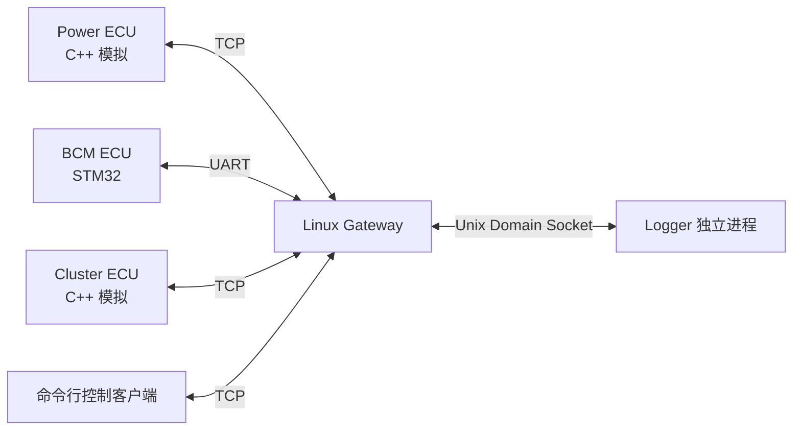
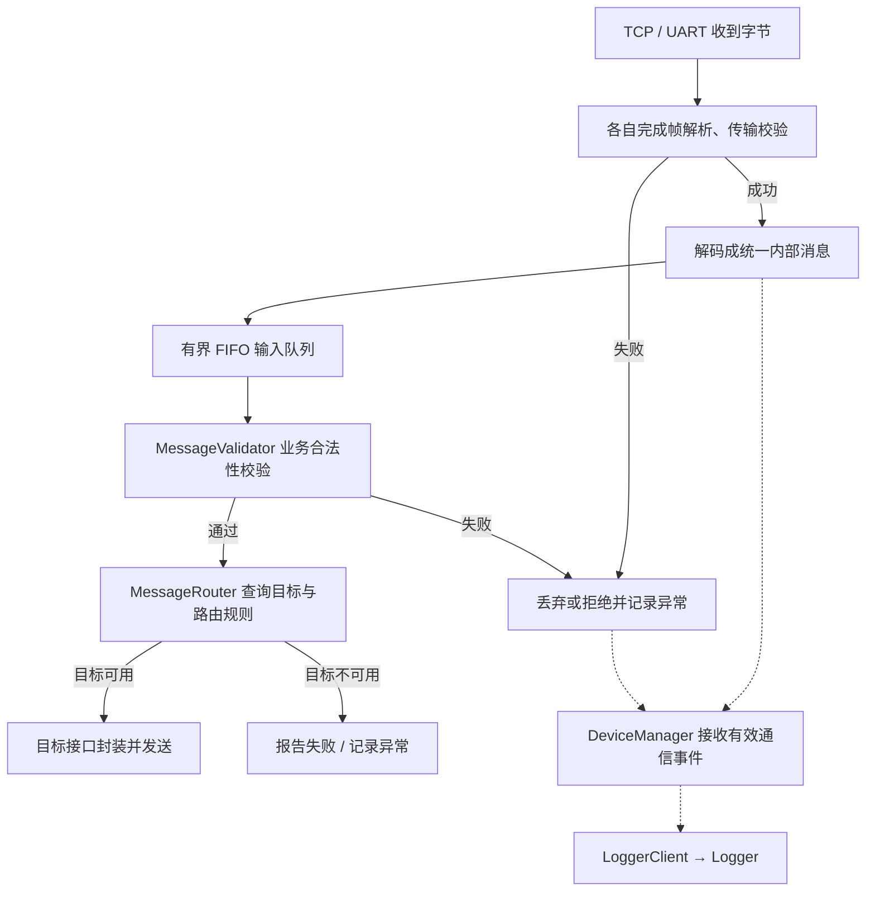

# 汽车 ECU 通信网关系统详细设计说明书 V1.0

> 状态：设计讨论稿（编码前基线）
> 核心原则：以 **Linux 网关** 为主体，ECU 作为独立业务节点；先验证基础通信、校验、路由和状态管理，再逐步扩展。
> 文档范围：第一阶段基础网关。PC 可视化界面、真实 CAN 总线、UDS 诊断等不在本版开发范围内。

## 1. 系统边界与节点部署

| 节点 | 职责 | 第一阶段部署 | 与网关的连接 |
|---|---|---|---|
| Power ECU（`0x01`） | 车速、发动机转速、冷却液温度及动力状态上报 | WSL2 Ubuntu 上独立 C++ 进程 | TCP |
| BCM ECU（`0x02`） | 车门/车灯状态上报；执行来自网关的车灯控制请求 | 正点原子 STM32F103VET6，C | UART |
| Cluster ECU（`0x03`） | 接收车辆状态，命令行显示及文字告警；不主动控制其他 ECU | WSL2 Ubuntu 上独立 C++ 进程 | TCP |
| Gateway（`0x04`） | 接收、解析、校验、路由转发、通信管理、在线状态监测 | WSL2 Ubuntu 上独立 C++ 进程 | TCP + UART |
| 外部控制客户端（预留 `0x05`） | 发送远程车灯控制请求；第一阶段可用简单命令行测试客户端 | 运行于 PC 或 WSL2 | TCP |
| Logger | 独立记录网关日志，供 IPC 学习 | WSL2 Ubuntu 上独立 C++ 进程 | Unix Domain Socket |

**部署边界说明：** 三个 ECU 是**逻辑上独立的通信节点**，消息必须经过网关；这不表示第一阶段存在三条真实、物理隔离的车载网络。后续再进行 CAN 多网络和嵌入式 Linux 硬件部署。



## 2. 网关模块职责

| 模块 | 输入 | 处理职责 | 输出 |
|---|---|---|---|
| `TcpTransport` | TCP 字节流 | 按长度前缀提取完整 JSON 帧；网络连接与收发 | 统一消息 / 发送数据 |
| `UartTransport` | UART 字节流 | 帧头同步、长度与 CRC 校验、二进制消息解码 | 统一消息 / 发送数据 |
| `MessageValidator` | 统一内部消息 | 校验源/目标身份、消息类型、业务载荷和允许的通信关系 | 合法消息 / 拒绝原因 |
| `MessageRouter` | 已校验消息 | 根据目标 ECU、路由规则、连接状态选择出口 | 待发送消息 |
| `DeviceManager` | 连接事件、心跳、异常事件 | ECU 状态维护、心跳超时、异常统计与恢复 | 状态变更事件 |
| `LoggerClient` | 网关日志事件 | 经本地 IPC 发给 Logger，不阻塞核心业务流程 | Logger 日志消息 |
| `Logger`（独立进程） | IPC 日志消息 | 格式化并写入文件 | 日志文件 |

通信模块负责**传输帧合法性**；核心校验模块负责**业务合法性**。Logger 不决定 ECU 在线/离线状态。

## 3. 统一业务消息

### 3.1 公共字段

统一消息用于网关内部处理。传输长度属于外层封装，**不重复放进业务消息**。

| 字段 | 用途 | 建议类型（实现阶段可调整） |
|---|---|---|
| `src_id` | 源 ECU / 控制端 ID | `uint8_t` |
| `dst_id` | 目标 ECU ID | `uint8_t` |
| `msg_type` | 消息类型 | `uint8_t` |
| `seq` | 标识一次消息，便于请求/响应关联 | `uint16_t` |
| `payload` | 与消息类型和源 ECU 相关的业务数据 | 结构化数据 |

### 3.2 消息类型

| 值      | 类型                  | 载荷规则                                            |
| ------ | ------------------- | ----------------------------------------------- |
| `0x01` | 状态上报 `STATUS`       | 同一 ECU 多项相关状态可批量上报；重要事件可即时单独上报                  |
| `0x02` | 控制请求 `CONTROL_REQ`  | `device`（控制对象）+ `action`（动作）                    |
| `0x03` | 控制响应 `CONTROL_RESP` | `result`（成功/失败）+ `error_code`（错误原因），并复用请求 `seq` |
| `0x04` | 心跳 `HEARTBEAT`      | 无业务载荷，用于辅助判断通信活跃性                               |

**业务限制：** Cluster ECU 不主动控制其他 ECU。远程车灯控制来自外部控制客户端，经网关转发给 BCM，BCM 执行并回送结果。操作结果不能仅凭网关成功转发就认定执行成功。

### 3.3 状态数据示例（逻辑结构）

```json
{
  "src_id": 1,
  "dst_id": 3,
  "msg_type": 1,
  "seq": 1001,
  "payload": {
    "speed_kmh": 60,
    "rpm": 2000,
    "coolant_temp_c": 85,
    "engine_status": "RUNNING"
  }
}
```

BCM 载荷可包含车门开关/车锁状态、近光灯/远光灯/左右转向灯状态；第一阶段**不实现车锁远程控制**。蜂鸣器不纳入第一阶段需求。

## 4. TCP 与 UART 传输帧

### 4.1 TCP：长度前缀 + JSON

```text
[4 字节 JSON 正文字节数（大端）][JSON UTF-8 正文]
```

- 4 字节长度**不包括**长度字段自身；JSON 必须在获取完整帧后解析。
- 接收端缓存未完整的字节，允许一次 `recv` 获得半帧、多帧或多帧的一部分。
- 正文长度上限暂按 **4096 字节（待测试确认）**；超限拒绝并按连接错误策略处理。
- JSON 仅为 TCP 传输编码；网关接收后转为统一内部消息。

### 4.2 UART：帧头 + 长度 + 二进制消息 + CRC16

```text
[AA 55][2 字节业务消息长度（大端）][二进制业务消息][2 字节 CRC16]
```

- 帧头用于同步和异常后的重同步；长度用于判断完整帧边界。
- 二进制业务消息仅编码公共字段和业务载荷，不重复存放传输帧长度。
- CRC 初步选 `CRC-16/CCITT-FALSE`：多项式 `0x1021`，初始值 `0xFFFF`，无反射，最终异或 `0x0000`；**校验范围为长度字段 + 二进制业务消息**，不含帧头和 CRC 自身。
- 2 字节 CRC 的发送字节序初步使用大端（实施时两端统一）。
- UART 最大业务消息长度、各业务二进制载荷字段布局、发送周期和超时值：**待详细实现前最终确认**。

## 5. 网关内处理流程



示例：Power ECU 的车速状态走 **TCP 接收 → JSON 完整帧解析 → 内部消息 → 业务队列 → 校验 → 路由 → TCP 发送给 Cluster ECU**。BCM 的车灯状态可经 UART 收到、解码，再经 TCP 转给 Cluster ECU。

## 6. 并发与消息队列

- TCP 连接采用 **非阻塞 Socket + epoll** 事件驱动；UART 收发与业务处理分开，避免阻塞网络事件处理。
- 多个接收者将完整的统一消息送入**线程安全、有界 FIFO 队列**；业务工作线程消费并处理。
- 使用**互斥锁**保护队列操作；**条件变量**用于在队列为空时休眠和在新消息到达时唤醒。
- 持锁只做短时间入队/出队，**不得持锁执行耗时业务或网络发送**。
- 正常情况下 FIFO；**仅在队列拥塞/溢出时**按业务重要程度处理：
  - 周期性状态：可以按同 ECU/同数据项合并或替换过期状态，优先保留较新值；
  - 控制请求：不可静默丢弃，超载时明确拒绝并反馈；
  - 控制响应：不可静默丢弃，若无法处理需通知请求方失败并记录；
  - 心跳：应有不受普通业务队列长时间拥塞影响的处理路径。
- 顺序保证范围：FIFO 保证**入队顺序**，不等于多个独立 ECU 的全局实际发送顺序。对于同一 ECU 的先后依赖操作，应在后续测试中验证顺序规则。
- 队列容量、处理线程数量、拥塞阈值：**待压测确定**。

## 7. ECU 状态管理与异常处理

| 状态 | 含义 | 典型进入条件 |
|---|---|---|
| `NOT_CONNECTED` | 尚未完成连接/初始化 | 系统启动或 ECU 未接入 |
| `ONLINE` | 通信活跃 | 连接有效且收到有效心跳 |
| `DEGRADED` | 通信异常 | 连接仍存在但心跳超时，或通信异常达到阈值 |
| `OFFLINE` | 设备离线 | TCP 连接断开，或进一步确认失联 |

基本状态转换：

```text
未连接 --连接成功且收到有效心跳--> 在线
在线 --心跳超时--> 通信异常
通信异常 --连续 2 次有效心跳--> 在线
任意状态 --明确断链 / 进一步确认失联--> 离线
离线 --重新连接并通过在线确认--> 在线
```

补充约束：

- 对 STM32 UART，物理串口处于打开状态**不等于 ECU 在线**；主要依赖心跳和有效通信判断。
- 对 TCP，连接关闭事件可直接触发离线；TCP 未断但心跳停止则先判通信异常。
- ECU 掉线时，通知 Cluster ECU 将相关车速/转速等数据**标记无效**，不能继续当作实时有效值展示。
- DeviceManager 负责当前状态、异常计数和恢复；Logger 只负责持久化事件记录。
- 心跳周期、首次连接容忍期、异常到离线的确认阈值：**待测试确定**。心跳本身只能确认通信程序可响应，不能证明 ECU 所有硬件功能正常。

## 8. 模块接口约定（逻辑级）

| 逻辑接口 | 输入 | 输出/效果 |
|---|---|---|
| `decodeFrame(transportBytes)` | TCP/UART 字节流 | 完整传输帧或传输错误 |
| `toInternalMessage(frame)` | 已解帧的 JSON/二进制消息 | `InternalMessage` 或解析错误 |
| `enqueue(message)` | `InternalMessage` | 入队成功或拥塞处理结果 |
| `validate(message)` | `InternalMessage` | 合法/非法及原因 |
| `route(message)` | 合法消息 | 目标 ECU、出口接口或路由失败 |
| `sendToEcu(destination, message)` | 目标与消息 | 发送提交结果；不等于执行完成 |
| `updateDeviceState(event)` | 连接/心跳/异常事件 | ECU 状态变化及通知 |
| `emitLog(event)` | 日志事件 | 交给 Logger 的 IPC 消息 |

> 上表为**模块能力约定**，不是最终 C++ 函数签名；最终类、函数、回调及跨线程消息所有权在编码前确定。

## 9. 第一阶段验收与测试

| 验收项 | 最小测试场景 |
|---|---|
| TCP 收发 | Power/Cluster 同时连接；拆包、粘包与连续报文正确 |
| UART 收发 | STM32 BCM 与 Linux 双向通信、CRC 错帧拒绝 |
| 报文校验 | 拒绝非法长度、非法 ECU、非法业务请求 |
| 路由转发 | 动力状态 → 仪表；BCM 状态 → 仪表 |
| 远程控制 | 命令行测试客户端 → Gateway → BCM LED；BCM 返回关联 `seq` 的执行结果 |
| 状态监测 | 心跳停止、TCP 断链、重新在线与状态更新 |
| 并发稳定性 | TCP 与 UART 并发发送；队列满时按定义处理，不崩溃 |
| IPC 日志 | Gateway 异常事件可经 Unix Domain Socket 交给独立 Logger |

## 10. 尚需在实现前确认的参数

这些内容**尚未在讨论中达成最终一致**，不能把示例值误当成硬性需求：

1. TCP 监听端口、ECU 与客户端连接身份绑定方式。
2. UART 波特率、具体引脚、接口方式与 WSL2 串口接入方案。
3. UART 二进制 `payload` 逐字段布局、取值单位与最大帧长度。
4. 心跳发送间隔、超时阈值、异常恢复确认条件的定量值。
5. 队列容量、线程数、报文合并与过载拒绝机制。
6. 错误码枚举、日志格式、命令行客户端具体命令。

## 11. 推荐编码启动顺序

1. 建立 Linux C++17/CMake 工程和 **TCP 长度帧编解码单元测试**。
2. 实现模拟 Power ECU、Cluster ECU 的最小连接与转发闭环。
3. 加入内部消息、校验、路由、FIFO 队列和设备状态管理。
4. 加入 UART 二进制编解码与 STM32 BCM 真机通信。
5. 加入命令行远程车灯控制、Logger IPC 与异常测试。

**本设计文档服务于编码，不要求所有未来高级功能在开发前一次性设计完成。**
